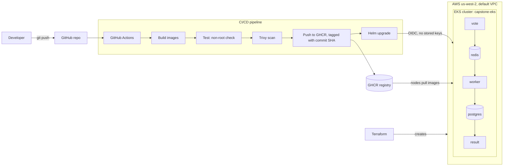

# Capstone 1: Ship It (Voting App)

From code to automatic deployment: a microservices voting app, hardened in Docker, scanned in CI, and deployed to AWS EKS with Helm, with every piece of infrastructure built from code.

Forked from [dockersamples/example-voting-app](https://github.com/dockersamples/example-voting-app).

## Architecture



**How a vote travels:** `vote` (Python) → Redis queue → `worker` (.NET) → PostgreSQL → `result` (Node.js, live updates over socket.io).

## Repository layout

| Path | What it is |
|---|---|
| `vote/`, `result/`, `worker/` | App services, each with a hardened Dockerfile and `.dockerignore` |
| `docker-compose.yml` | Run the whole app locally |
| `terraform/` | EKS cluster on the default VPC, IAM roles, GitHub OIDC trust |
| `helm/voting-app/` | One chart, one values file, for all five services |
| `.github/workflows/ci.yml` | Build, test, scan, push and deploy pipeline |
| `docs/` | Evidence log and screenshots |

## Step 1: Run it locally

```bash
docker compose up --build
```

- Vote: http://localhost:8080
- Results: http://localhost:8081

## Step 2: Containerized safely

| Requirement | How |
|---|---|
| Pinned base images | Exact version plus `@sha256` digest, e.g. `python:3.11.17-slim-trixie`, `node:22-slim@sha256:...`, `dotnet/runtime:8.0@sha256:...` |
| Non-root | `vote` and `worker` run as `appuser` (uid 10001); `result` runs as the built-in `node` user |
| Ports | Non-root users cannot bind ports below 1024, so production images listen on 8080 |
| `.dockerignore` | One per service, keeps `.git`, build output and caches out of images |
| Multi-stage builds | `vote` has `dev` and `final` stages; `worker` compiles in the SDK image and ships only the runtime |

## Step 3: Kubernetes cluster with Terraform

```bash
cd terraform
terraform init
terraform apply      # about 11 minutes
aws eks update-kubeconfig --region us-west-2 --name capstone-eks
kubectl get nodes
terraform destroy    # always destroy when finished
```

- Uses the existing **default VPC** through `data` sources, so Terraform never creates or deletes the network.
- Two IAM roles: one for the EKS control plane, one for the worker nodes.
- Node group: 2 × `m7i-flex.large` (free-tier eligible on this account; `t3.medium` is rejected on the AWS Free plan).
- The whole environment was destroyed and recreated from code to prove it rebuilds.
- State files and saved plans are git-ignored. No AWS keys are stored in code.

## Step 4: CI pipeline (GitHub Actions)

On every push to `main`, for each of `vote`, `result` and `worker` in parallel:

1. **Build** the image (Buildx with GitHub Actions cache)
2. **Test** that the container does not run as root
3. **Scan** with Trivy and fail on any fixable CRITICAL vulnerability
4. **Push** to GHCR as `ghcr.io/slay1der/<service>:<commit-sha>`

Pull requests run steps 1 to 3 only. Third-party actions such as Trivy are pinned to a commit SHA.

## Step 5: Deploy and roll back with Helm

The pipeline's `deploy` job runs after all images pass, gets **temporary AWS credentials through GitHub OIDC** (no stored keys) and runs:

```bash
helm upgrade --install voting ./helm/voting-app --set image.tag=<commit-sha> --wait
```

If the cluster is not running, the deploy job skips instead of failing.

Manual deploy and rollback:

```bash
helm install voting ./helm/voting-app --set image.tag=$(git rev-parse HEAD)

helm upgrade voting ./helm/voting-app --set image.tag=broken-on-purpose
kubectl get pods            # new pods: ImagePullBackOff, old pods keep serving
helm history voting
helm rollback voting 1
kubectl get pods            # healthy again
```

Open the app on the cluster:

```bash
kubectl port-forward svc/vote 8080:8080
kubectl port-forward svc/result 8081:8081
```

One-time GitHub setup for the deploy job: **Settings → Secrets and variables → Actions → Variables**, add `AWS_ROLE_ARN` with the `github_deploy_role_arn` value from `terraform output`.

## Security fixes found by the pipeline

Trivy blocked the first builds. Fixes:

| Service | Finding | Fix |
|---|---|---|
| worker | `System.Drawing.Common 5.0.0`, CVE-2021-24112 (critical, pulled in transitively by StackExchange.Redis) | Pinned `System.Drawing.Common 5.0.3` |
| worker | .NET 7 runtime on end-of-life Debian 11 (e.g. `libkrb5support0`) | Upgraded to .NET 8 LTS |
| result | Node 18 end-of-life base image | Upgraded to Node 22 LTS |
| result | Vulnerable transitive npm packages | `npm audit fix` (lock file only, no major upgrades) |

## Troubleshooting log

| Problem | Cause | Fix |
|---|---|---|
| Worker stuck on "Waiting for db" in Codespaces | `iptables-legacy` FORWARD policy was DROP, only `docker0` allowed, so Compose bridge networks were blocked | `sudo iptables-legacy -P FORWARD ACCEPT` (dev Codespace only) |
| Build cache and container layer errors after Codespace restarts | Corrupted Docker storage | `docker builder prune -af`, `docker compose down` |
| EKS node group stuck in CREATING with no EC2 instances | Free-plan account cannot launch `t3.medium` (found in the Auto Scaling Group activity log) | Switched to free-tier eligible `m7i-flex.large` |
| CI: `unable to find version 0.28.0` | Trivy action tag did not exist | Pinned to the v0.36.0 commit SHA |
| CI: `unknown blob` on push | Layer lost between Buildx and `docker push` | Push with `docker/build-push-action` and `push: true` |
| CI deploy: `Not authorized to perform sts:AssumeRoleWithWebIdentity` | GitHub's OIDC `sub` claim includes immutable owner and repo IDs (`repo:Slay1der@276008203/example-voting-app@1434778703:ref:refs/heads/main`), so the trust rule did not match | Printed the claims in a debug step, then matched the IAM trust policy to the real `sub` |

## Known limitations

- The database password is the demo default because the upstream `worker` and `result` code hard-code the connection string. Next step: read it from environment variables and supply it from a Kubernetes Secret created outside Git.
- Redis and Postgres use `emptyDir`, so data is lost when pods restart. Next step: a PersistentVolumeClaim.
- The EKS API endpoint is public. Next step: restrict `public_access_cidrs`.
- Terraform state is local. Next step: remote state in S3 with locking.

## Cost

About $0.20 per hour while the cluster runs (EKS control plane plus two nodes). The cluster is destroyed whenever it is not in use and rebuilt from code in about 12 minutes.

## Screenshots and evidence

See the [evidence log](docs/evidence.md) for terminal output and all screenshots from the build, debugging, deploy and rollback.
